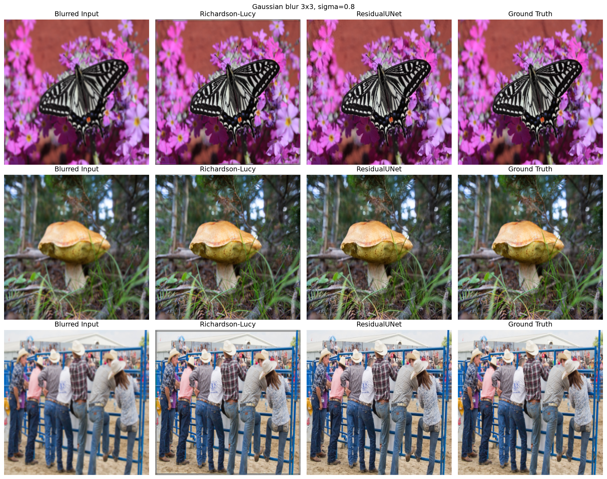
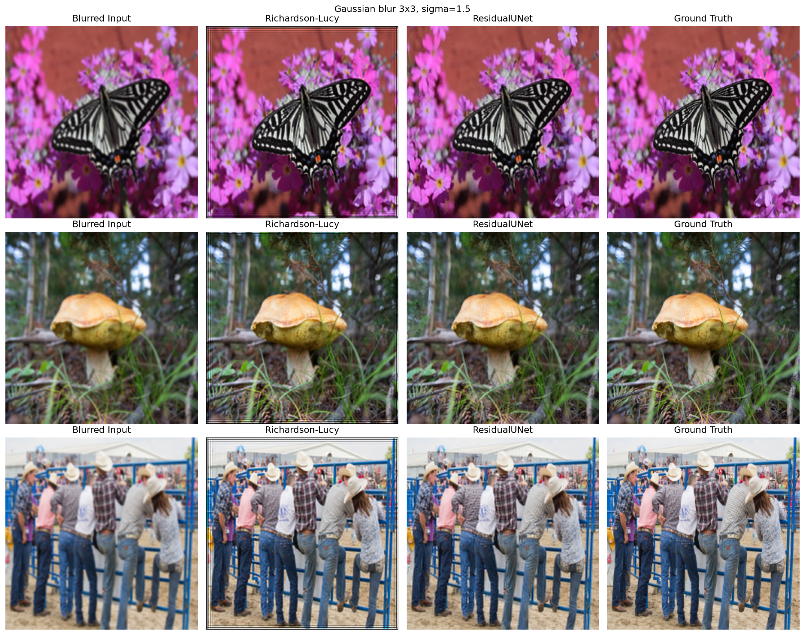
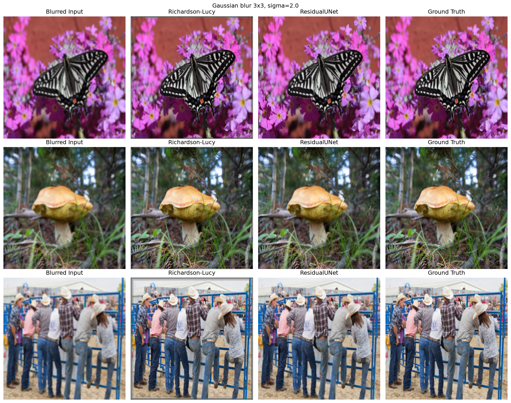
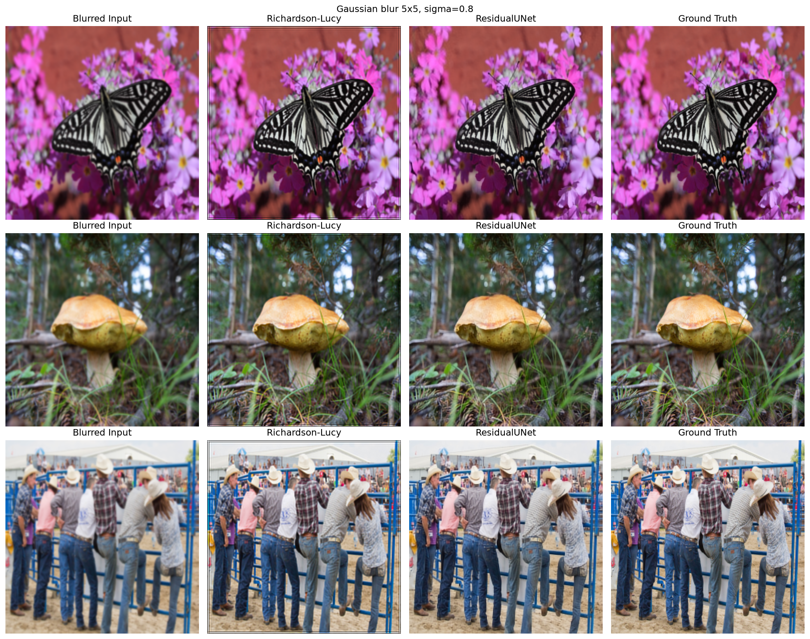
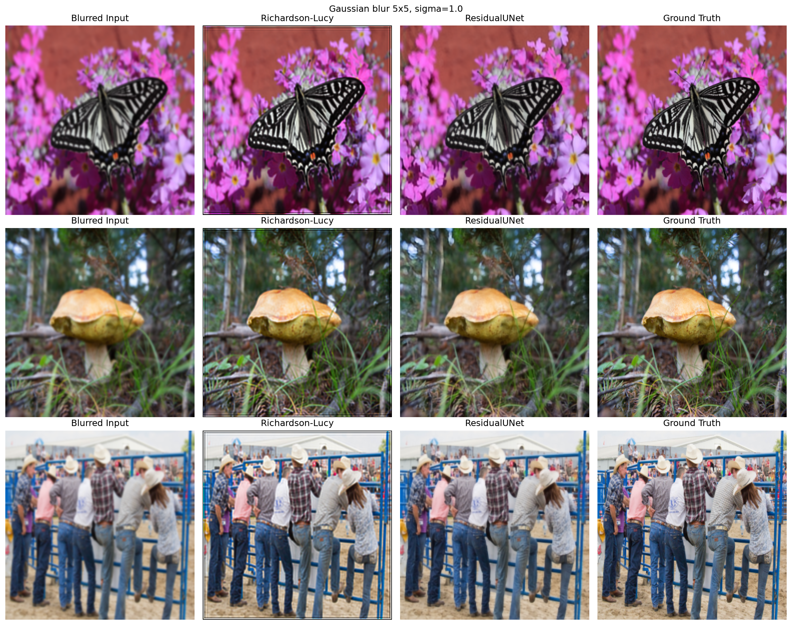
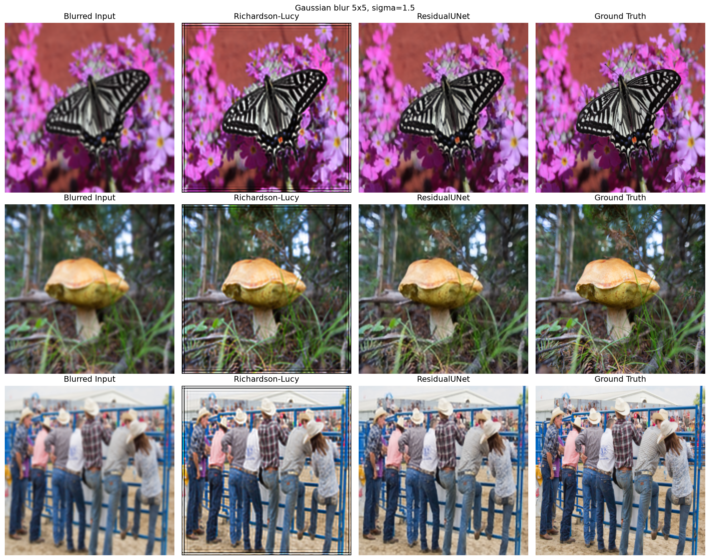
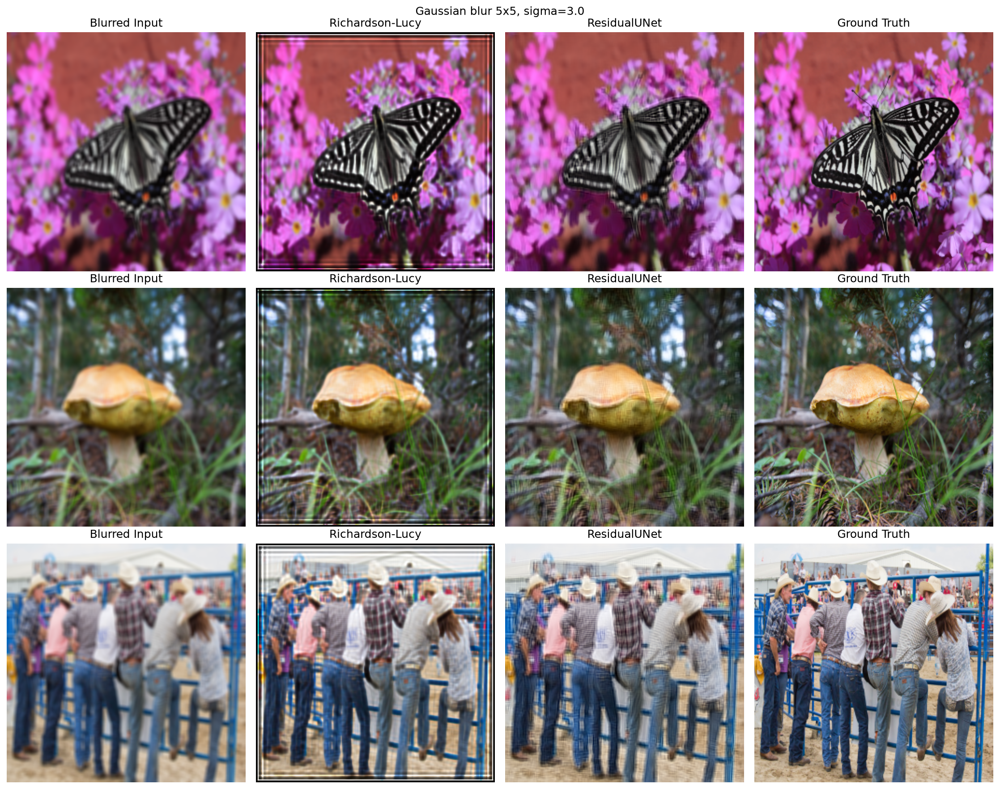

# 2.3 Deblurring

## 1. Model

Do rekonstrukcji ostrego obrazu wykorzystano głęboką sieć neuronową typu
U-Net z połączeniami rezydualnymi — sieć przewiduje poprawkę, którą dodaje
się do obrazu wejściowego, zamiast odtwarzać cały obraz od zera. Takie
podejście ułatwia uczenie i stabilizuje trening.

Jako punkt odniesienia (baseline) zastosowano klasyczną, nieuczoną metodę
dekonwolucji — algorytm Richardsona-Lucy'ego, który odtwarza ostry obraz na
podstawie znanego kształtu rozmycia (tzw. PSF).

## 2. Funkcja straty

Model trenowano, minimalizując sumę straty pikselowej (różnica wartości
pikseli między predykcją a oryginalnym ostrym obrazem) oraz straty
percepcyjnej opartej na cechach z sieci VGG16, która premiuje podobieństwo
"wizualne" obrazów, a nie tylko identyczność pikseli.

## 3. Metryki ewaluacyjne

- **PSNR (dB)** — miara błędu pikselowego, im wyższa wartość, tym lepiej.
- **SSIM** — podobieństwo strukturalne (zakres 0–1), im wyżej, tym lepiej.
- **LPIPS** — percepcyjna odległość między obrazami, im niżej, tym lepiej;
  lepiej niż PSNR/SSIM odzwierciedla ludzką ocenę jakości obrazu.

## 4. Eksperymenty

Model wytrenowano na rozmyciu gaussowskim o dwóch konfiguracjach: jądro 3x3
(σ=1.0) oraz jądro 5x5 (σ=1.5). Następnie, bez żadnego dodatkowego treningu,
ten sam model przetestowano na szerszym zakresie siły rozmycia, aby
sprawdzić jego zdolność do generalizacji. Dla każdej konfiguracji
porównano metodę klasyczną (Richardson-Lucy) z siecią neuronową.

### 4.1 Jądro rozmycia 3x3

#### Eksperyment: σ = 0.5 (rozmycie słabsze niż treningowe)

| Metoda | PSNR (dB) | SSIM | LPIPS |
|---|---:|---:|---:|
| Richardson-Lucy | 52.78 | 0.999 | 0.0003 |
| Sieć neuronowa | 23.40 | 0.843 | 0.255 |

#### Eksperyment: σ = 0.8 (rozmycie słabsze niż treningowe)

| Metoda | PSNR (dB) | SSIM | LPIPS |
|---|---:|---:|---:|
| Richardson-Lucy | 22.92 | 0.935 | 0.111 |
| Sieć neuronowa | 33.33 | 0.970 | 0.014 |

#### Eksperyment: σ = 1.0 (siła rozmycia użyta w treningu)

| Metoda | PSNR (dB) | SSIM | LPIPS |
|---|---:|---:|---:|
| Richardson-Lucy | 20.88 | 0.908 | 0.185 |
| Sieć neuronowa | 30.07 | 0.933 | 0.031 |

#### Eksperyment: σ = 1.5 (rozmycie silniejsze niż treningowe)

| Metoda | PSNR (dB) | SSIM | LPIPS |
|---|---:|---:|---:|
| Richardson-Lucy | 20.66 | 0.897 | 0.231 |
| Sieć neuronowa | 26.49 | 0.854 | 0.052 |

#### Eksperyment: σ = 2.0 (rozmycie silniejsze niż treningowe)

| Metoda | PSNR (dB) | SSIM | LPIPS |
|---|---:|---:|---:|
| Richardson-Lucy | 20.66 | 0.894 | 0.233 |
| Sieć neuronowa | 25.47 | 0.822 | 0.051 |

### 4.2 Jądro rozmycia 5x5

#### Eksperyment: σ = 0.8 (rozmycie słabsze niż treningowe)

| Metoda | PSNR (dB) | SSIM | LPIPS |
|---|---:|---:|---:|
| Richardson-Lucy | 23.96 | 0.941 | 0.104 |
| Sieć neuronowa | 34.10 | 0.974 | 0.010 |

#### Eksperyment: σ = 1.0 (rozmycie słabsze niż treningowe)

| Metoda | PSNR (dB) | SSIM | LPIPS |
|---|---:|---:|---:|
| Richardson-Lucy | 21.72 | 0.896 | 0.227 |
| Sieć neuronowa | 29.64 | 0.929 | 0.085 |

#### Eksperyment: σ = 1.5 (siła rozmycia użyta w treningu)

| Metoda | PSNR (dB) | SSIM | LPIPS |
|---|---:|---:|---:|
| Richardson-Lucy | 19.93 | 0.812 | 0.372 |
| Sieć neuronowa | 26.75 | 0.857 | 0.132 |

#### Eksperyment: σ = 2.0 (rozmycie silniejsze niż treningowe)

| Metoda | PSNR (dB) | SSIM | LPIPS |
|---|---:|---:|---:|
| Richardson-Lucy | 18.50 | 0.785 | 0.374 |
| Sieć neuronowa | 24.49 | 0.768 | 0.115 |

#### Eksperyment: σ = 3.0 (rozmycie znacznie silniejsze niż treningowe)

| Metoda | PSNR (dB) | SSIM | LPIPS |
|---|---:|---:|---:|
| Richardson-Lucy | 18.06 | 0.774 | 0.349 |
| Sieć neuronowa | 23.10 | 0.695 | 0.164 |

## 5. Wnioski

- Dla rozmycia o sile zbliżonej do treningowej lub silniejszej (σ ≥ 0.8)
  sieć neuronowa wyraźnie przewyższa metodę klasyczną we wszystkich trzech
  metrykach, a różnica w LPIPS jest szczególnie duża — obrazy wyglądają
  percepcyjnie dużo bliżej oryginału.
- Dla bardzo słabego rozmycia (3x3, σ=0.5, niemal brak rozmycia) sieć
  wypada gorzej niż metoda klasyczna — nie rozpoznaje, że obraz jest już
  prawie ostry, i wprowadza niepotrzebne zmiany. Richardson-Lucy radzi sobie
  tu niemal idealnie, ponieważ zna dokładny kształt rozmycia.
- Wraz ze wzrostem siły rozmycia powyżej wartości treningowych jakość
  rekonstrukcji sieci spada, jednak nadal pozostaje wyraźnie lepsza od
  metody klasycznej pod względem percepcyjnym (LPIPS).
- Metoda klasyczna korzysta z dokładnie znanego kształtu rozmycia, co w
  praktyce rzadko jest dostępne — mimo to przegrywa z siecią w większości
  testowanych przypadków, poza skrajnie słabym rozmyciem.
