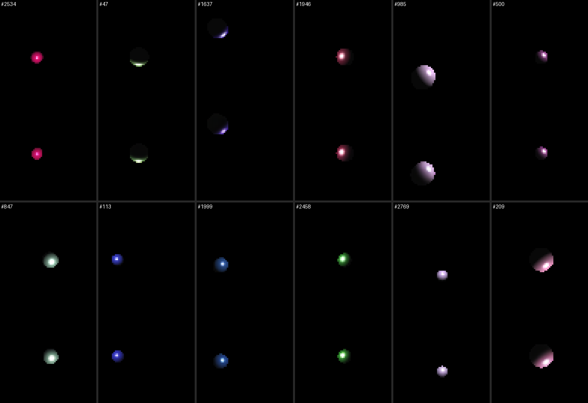
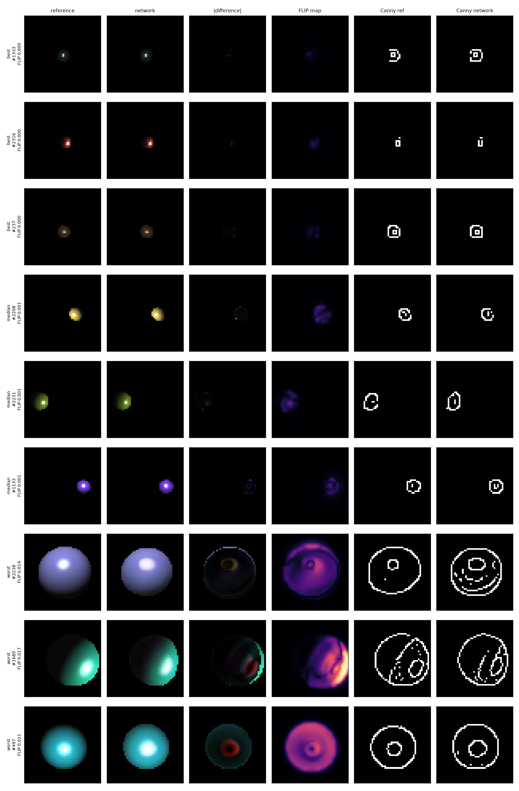
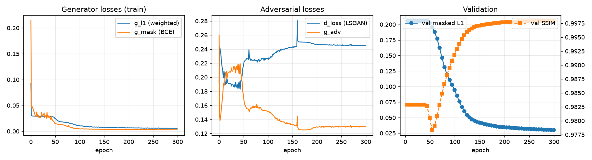

# SIGK Project 3 – neural Phong renderer (conditional GAN)

```bash
pip install -r requirements.txt
cd src
python main.py --window headless     # 3000 images -> ../data/phong/
python ../scripts/check_dataset.py
python ../scripts/make_split.py
python -m neural.train --smoke       # quick check; then: python -m neural.train --run_name relative_gan
python main.py neural --checkpoint ../runs/relative_gan/best.pt   # live comparison (SPACE = new scene)
```

Ablations: `--no_gan`, `--encoding raw`, `--pixel_rel_maps`.

## Kaggle

The dataset is committed in git (`data/phong`, 12 MB);

```bash
git add -A && git commit -m "data + job" && git push
uvx --with six kaggle kernels push -p jobs/2026-11-24_01_gan-v1        # set <kaggle-user> in kernel-metadata.json first
uvx --with six kaggle kernels status <kaggle-user>/sigk3-gan-v1
```

Fetch the results (waits until the kernel finishes, then downloads `best.pt`, `losses.csv`, samples into `runs/`),
then evaluate on the 600 test images (FLIP, LPIPS, SSIM, Hausdorff + figures):

```bash
python scripts/fetch_kaggle.py <kaggle-user>/sigk3-gan-v1
cd src && python -m neural.evaluate --checkpoint ../runs/relative_gan/best.pt
# -> ../runs/relative_gan/eval_test/{results.md, results.json, per_image.csv, images/, figures/}
```

## Results (`relative_gan`: relative encoding + GAN, 300 epochs, 600 test images)

| Method | FLIP ↓ | LPIPS ↓ | SSIM ↑ | Hausdorff ↓ [px] |
|---|---|---|---|---|
| neural_renderer | 0.0014 ± 0.0015 | 0.0028 ± 0.0051 | 0.9989 ± 0.0019 | 2.33 ± 2.37 |
| black_image (baseline) | 0.0070 ± 0.0041 | 0.1983 ± 0.0680 | 0.9843 ± 0.0096 | 181.02 (penalty) |
| mean_train_image (baseline) | 0.0182 ± 0.0039 | 0.1997 ± 0.0679 | 0.9314 ± 0.0078 | 181.02 (penalty) |

SSIM/FLIP are inflated by the black background (a black image already scores SSIM 0.984); LPIPS and Hausdorff separate
the methods much better. Single run, single seed; ablations (`--no_gan`, `--encoding raw`, `--pixel_rel_maps`) not run yet.

Reference (top) vs. network (bottom), random test images, cropped around the sphere:



Best / median / worst test cases by FLIP (reference | network | difference | FLIP map | Canny ref | Canny network):





More in [`report/relative_gan/`](report/relative_gan/): `results.md/json`, `per_image.csv` (metrics of every test image),
`losses.csv`, `config.json`, `metric_hists.png`, training samples (`samples/`, reference on top, network below).
Dataset statistics: `figures/`. The checkpoint (`best.pt`, 39 MB) is not in git.
